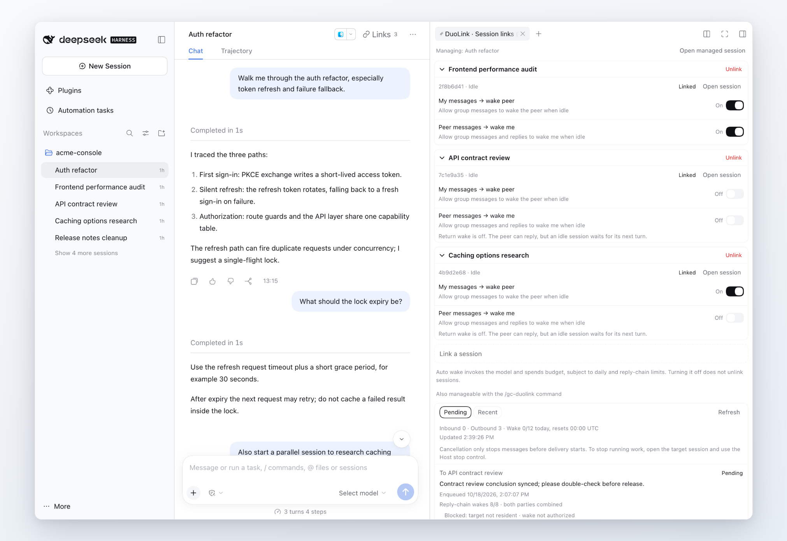

[中文](README.zh.md) | English

# DuoLink

`dsh-gc-duolink`

Bidirectional Session messaging and utilities for DeepSeek Harness Desktop and Web: create links, exchange durable messages, manage wake budgets, spawn ordinary Sessions with an initial model. It uses official DSH `0.2.0-rc.2` public APIs without changing the Host.

**Preview release: [0.6.1-beta](https://github.com/cskeleton/dsh-gc-duolink/releases/tag/v0.6.1-beta).** DuoLink uses independent configuration, storage and protocol identities. It does not load or migrate old `dsh-session-link` settings, mail, link groups or ledgers. Disable or uninstall the old plugin and recreate links and wake grants in DuoLink. Keep old storage files if you need them; do not rename or copy them into the new domain. See [namespace isolation](docs/plans/duolink-isolation.md) and [verification](VERIFICATION.md).

## Visual guide



The cover shows a normal working window: the Session sidebar, a live conversation and the DuoLink management panel. A tour in six figures of the main features and UI interactions — entry points, the quick linker, the management panel, the mailbox, wake-budget extension and spawned Sessions — is in [docs/introduction.md](docs/introduction.md) ([中文](docs/introduction.zh.md)).

## Usage

Use DSH's built-in **Copy Session ID** action in a Session row's `…` menu. DuoLink does not add a second copy action. Its **Session links…** entry uses the Host's menu component for matching typography and spacing.

Click **Links** in the Session header, find a peer, confirm the wake settings in both directions, and create the link. The right panel opens peers, changes wake settings and confirms unlinking. The sidebar's right-hand chain action and `… → Session links…` manage the clicked Session without switching the main conversation. The sidebar chain action appears only for Sessions with at least one link and disappears after the last link is removed, independently of execution and wake state. Unlinked Sessions remain accessible through the menu.

The interface follows DSH's shared language preference, including changes while the panel is open. The picker initially shows the 3 most recently active eligible Sessions; **Show more** expands it to 8. Search matches the entire eligible catalog before applying the display limit.

Link cards can collapse from their title bar, with **Unlink** on the right and confirmation before removal. Pair cards display the peer title once, followed by its ID/status and wake controls; larger groups retain individual receiving-member names.

Two-member groups show “My messages → wake peer” and “Peer messages → wake me.” Larger groups grant wake permission per receiving member; that setting applies to every sender in the group. Both switches default to on for a new UI link and require confirmation. Existing groups and human-disabled switches receive no additional grants. Only existing, unarchived ordinary top-level Sessions can link. Duplicate Session pairs are rejected within the serialized admission queue.

Messages carry non-human peer attribution. They share message text, not model history or permissions. A running peer receives a follow-up; an idle peer without a wake grant retains mail durably until its next turn. Automatic wakes obey daily, per-message and reply-chain budgets.

```text
/gc-duolink list
/gc-duolink add <peer-session-id> [wake]
/gc-duolink wake <peer-session-id> on|off
/gc-duolink revoke <link-id>
```

Five tools are available to the model:

- `gc_duolink_list_links`: list links and reachable peers.
- `gc_duolink_send_message`: send or reply with `in_reply_to`; self-send and model selection are rejected.
- `gc_duolink_cancel_message`: cancel mail not yet inserted into the peer's Session.
- `gc_duolink_spawn_session`: create an ordinary Session, link it and deliver its initial task; optionally select its initial model.
- `gc_duolink_list_models`: query deployed provider/model/effort metadata, optionally filtered by `provider`.

Tools and commands mount in eligible top-level Agents' preset scopes, never globally. Omitting `presets` includes `standard`, `ptc`, `cordis` and the public registry's eligible effective default. An explicit list is an exact allowlist; an empty list disables mounting. Minimal and child Agents are excluded; archived Sessions cannot invoke these tools. Eligibility is checked at Agent creation and preset changes. Changing the default alone does not remount existing Agents.

The managed Session's mailbox shows pending/recent mail, known blocking conditions and wake budgets. Either original participant can cancel ordinary queued mail. The button is a snapshot: the Host returns `cancelled`, `already_terminal` or `too_late` with the latest delivery state. Potentially held or delivered input cannot be recalled. Open the target's native Session to use the Host stop control when it is running. Unlinking neither stops a running Session nor recalls delivered input. Legacy experimental reports remain read-only diagnostics.

For information-only sends:

```json
{ "session_id": "session-peer-id", "message": "Sharing the result; no acknowledgement needed.", "wake": false }
```

Omitted `wake` or `true` retains existing behavior under link grants and budgets. `false` requests no idle wake or cold resume and spends no wake budget. Running peers still receive next-turn input, which may create another turn; other authorized wakes or human activity can also deliver queued mail in FIFO order. This is not a zero-compute guarantee. Intent is persisted with each message. Replays use the original record and cannot elevate `false` to `true`. Spawn does not accept `wake`; its initial task and independent wake grants are unchanged. New frames discourage courtesy-only replies and count the added guidance toward the byte limit; existing bodies are not rewritten. **Downgrading to a plugin that does not recognize `wake` may lose the no-wake semantics.**

## Spawn directory and Workspace

Omit `cwd` to inherit the caller's actual directory and Workspace, creating a peer top-level Session. An ungrouped caller produces an ungrouped peer and keeps its own membership unchanged.

An explicit absolute `cwd` creates or reuses that exact directory's Workspace, even when it has never been opened in Desktop. Native Session creation makes missing directories. Workspace registration and membership are streamed to Desktop/Web without switching the current conversation. A subdirectory has its own Workspace; symlinks and dot segments reuse the canonical directory's existing registration and title.

Ordinary and `initial_model` spawns share this rule. The first task is admitted only after placement succeeds. Failure reports the existing Session/link; retrying the same call finishes placement without duplicating the Session. Completed placement never restores a human's later detach or Workspace deletion. Pending placement refuses to recreate a deleted recorded Workspace. Old completed calls and historical ungrouped Sessions are not migrated. Omission without a caller directory, explicit null/blank values, and relative paths fail explicitly.

```json
{ "task": "Review this project in parallel and report the findings" }
```

## Initial model selection

Query `gc_duolink_list_models`, then pass an optional strict object to spawn:

```json
{
  "cwd": "/absolute/path/project",
  "task": "A complete, self-contained task description",
  "initial_model": {
    "provider": "provider ID from the catalog",
    "model": "model ID belonging to that provider",
    "reasoning_effort": "effort ID supported by that exact model"
  }
}
```

Provider and model are required non-empty strings. Effort is optional: omission uses the selected model's own default, rather than the caller's effort. Extra nested fields are rejected. Without `initial_model`, spawn uses the original create/link/delivery flow. All spawn modes share a per-call concurrency lock: conflicting concurrent parameters return `SPAWN_REPLAY_CONFLICT`; ordinary completed-call replay retains its previous compatibility rules. Catalog membership is metadata, not proof of authentication or execution success.

The plugin writes the existing native `model/selection` event into the new Session and confirms durability before activation and task delivery. Native Session Controller owns subsequent requests and recovery. The choice persists across turns; later human model changes in the native UI take precedence. Spawn does not change the application default, override runtime selection, provide temporary task routes, perform fallback or rerun model failures.

The first spawn result text retains its original format. A second text block carries version 1 `gc-duolink/initial-model` metadata. The turn card labels it **Initial session model**, not the current model or evidence of successful execution. `queued` and `accepted` are delivery states only.

Replay reuses the original Session, link and task message. Selected spawn hashes the complete normalized request; changes to the model, full task, directory, title or grants are rejected. Replay cannot add or remove `initial_model`. An existing ID with unconfirmed ownership is never adopted, repaired or activated. A crash after Session creation but before ownership confirmation can leave an empty orphan Session; the error requests human inspection, and the plugin neither overwrites nor deletes it. Unlinked groups are never revived by replay.

Old top-level `provider`, `model`, `reasoning_effort`, `model_scope` and `on_model_unavailable` arguments are explicitly rejected. Send also rejects `initial_model`. Task decisions (`session_get_task`, `session_resolve_task`), task panels/cards and the `./tasks` export are retired.

## Delivery and wakes

- `queued` means durably stored in the mailbox; `accepted` means inserted into the target and successfully flushed. Neither means processed or completed. A delivery failure after storage stays queued; retry delivers the same message.
- A send error means the message was not stored, was cancelled before insertion, or names a blocked legacy report. It will not later be newly delivered. Cancellation after insertion cannot recall it; failed flushes retain receipt recovery. Each target receives mail in durable admission order.
- Idempotency keys commit with their messages. Cancelled, failed and revoked keys return `MESSAGE_UNDELIVERABLE`. Replies must name a message received by this Session. Reply-chain budgets span groups.
- Spawn owes its initial task one budgeted wake. `auto_awake` controls later messages and defaults to false. `wake_caller` defaults to `auto_awake` and can be set independently. The initial task does not add a return-direction grant. Replay preserves the original grants.
- UI/command links carry human grants; spawn links carry Session grants. Unlinking blocks undelivered mail but cannot retract inserted input. Unload refuses new operations, waits for in-flight operations and then closes storage.

## Installation

Download [dsh-gc-duolink-0.6.1-beta.tgz](https://github.com/cskeleton/dsh-gc-duolink/releases/download/v0.6.1-beta/dsh-gc-duolink-0.6.1-beta.tgz) from the prerelease and select it in the DSH plugin installer. Checksums and a delivery manifest accompany the archive. Earlier local 0.6.1 archives are test snapshots. The instructions below cover source development installs.

Build the directory first; development installs use `link:` without archives. Preset-registry and session-persistence are optional peers: ordinary tools can mount without them; selected spawn explicitly refuses missing public bootstrap services. Runtime peers resolve from the target profile. Disable peer auto-installation to avoid a second Host dependency tree.

```sh
pnpm install --frozen-lockfile
env -u DSH_SOURCE_ROOT pnpm build
```

For Web and other ordinary profiles:

```sh
dsh plugin --profile web add --ignore-scripts --config.auto-install-peers=false link:/absolute/path/dsh-gc-duolink
```

Electron exclusively manages Desktop profiles. Open Desktop once to initialize its profile, then quit it completely and use the bundled CLI:

```sh
DESKTOP_DSH='/Applications/DeepSeek Harness.app/Contents/Resources/runtime/cli/bin/dsh'
"$DESKTOP_DSH" plugin --profile desktop add --ignore-scripts --config.auto-install-peers=false link:/absolute/path/dsh-gc-duolink
```

Reopen the application afterward. Do not perform package operations while Desktop is running. The Plugins page can inspect, enable and disable the bundle. The final argument can also be `link:/absolute/path/dsh-gc-duolink` for a built local directory. Build and isolated checks do not switch an existing profile.

### Independent installation

Configure DuoLink as a fresh plugin. Recreate desired links and wake permissions through its UI or `/gc-duolink`; old plugin state is not imported, renamed, copied or deleted. Only the new configuration row IDs below affect DuoLink. The shared profile file `cordis.patch.yml` belongs to DSH; old rows in that file do not override DuoLink.

The default JSON backend stores DuoLink state at `$DSH_HOME/storages/gc_duolink.json`. It never falls back to `session_link.json`. A persisted product marker identifies owned storage; an old or foreign nonempty file copied to the new path is rejected. Do not manually rename old data files as a migration.

The standalone `dsh-client-ui-copy-session-id` source remains available. On DSH versions with the built-in copy action, keep that standalone plugin disabled to avoid duplicate menus. DuoLink no longer contains its own copy implementation. Building and validation do not change actual user profiles.

Uninstall Web with `dsh plugin --profile web remove dsh-gc-duolink`; for Desktop, quit first and use `"$DESKTOP_DSH" plugin --profile desktop remove dsh-gc-duolink`. Removal retains DuoLink data and Session history.

## Local directory and GitHub

The real checkout is `/Users/gc/Dev/MyProject/dsh-plugin/dsh-gc-duolink`. Its `.git`, `master`, commits and uncommitted changes are retained. There is no compatibility symlink at the old directory name. Existing old-profile dependency specs are not rewritten by source changes.

The existing GitHub repository has been renamed to [cskeleton/dsh-gc-duolink](https://github.com/cskeleton/dsh-gc-duolink), retaining its history, issues, tags and releases. Local `origin` now points to:

```text
https://github.com/cskeleton/dsh-gc-duolink.git
```

The former repository URL redirects to the new address; do not reuse the former name. English is the default `README.md`, with Chinese in `README.zh.md` and a language link on the first line. See [GitHub's documentation](https://docs.github.com/en/repositories/creating-and-managing-repositories/renaming-a-repository).

## Configuration

The plugin bundle file is `gc-duolink.patch.yml`. All externally registered identities are independent:

| Surface | DuoLink identity |
|---|---|
| Service / tools / command configuration rows | `gc-duolink` / `tool-gc-duolink` / `command-gc-duolink` |
| Storage domain | `gc_duolink` |
| Service and RPC | `gcDuolink` / `gcDuolink/*` |
| Command | `/gc-duolink` |
| Message source | `gc-duolink-message` |
| Initial-model metadata | `gc-duolink/initial-model` |

A profile's `cordis.patch.yml` can override configuration. A patch replaces the whole row configuration, so restate custom values you want to retain.

```yaml
- id: gc-duolink
  config:
    uiPollIntervalMs: 30000
    maxLinkMembers: 8
    maxPendingPerTarget: 16
    maxMessageBytes: 16384
    maxAutoWakesPerSessionPerDay: 12
    maxAutoWakesPerMessage: 1
    maxAutoWakesPerChain: 8
    maxDeliveryAttempts: 3
```

Defaults are 8 automatic wakes per reply chain, 12 per Session per UTC day, and 1 per message. The existing fields above override those defaults; explicit configuration wins. Configuration is read when the plugin loads, so reload the plugin after editing. Initial tasks still count, both directions share a chain, and historical chain usage does not reset each day.

An ordinary queued message whose chain budget is exhausted offers **Increase wake allowance**. Clicking opens a dialog with 4, 8 or a custom 1–100 additional wakes, the new limit, the receiving Session's daily budget and other known blockers. **Add and continue** persists the extension and attempts delivery of the selected message; Cancel neither writes nor wakes. The dialog never opens automatically.

Extensions belong only to that reply chain, shared across directions and groups, without resetting historical usage. Durable receipts prevent retry duplication; conflicting concurrent confirmations show the new budget and require another confirmation. Daily/message limits, wake grants, `wake:false`, archive state and unsupported task-report rejection still apply. Terminal messages are not resent and removed links are not restored. A legitimate wake can still co-deliver other queued mail in existing FIFO order. Allowance results and delivery results are distinct and never certify task completion. Only the human UI extends budgets; the five model tools are unchanged.

Downgrading to a version that does not recognize extension receipts may lose extra allowance and retry facts; no downgrade migration guarantee is provided. See the [development plan](docs/plans/chain-wake-budget.md).

For custom presets, configure both tool and command rows:

```yaml
- id: tool-gc-duolink
  config:
    presets: [standard, ptc, cordis, coding, my-custom-preset]
- id: command-gc-duolink
  config:
    presets: [standard, ptc, cordis, coding, my-custom-preset]
```

The poll interval is 1000–2147483647 milliseconds. UI consumers share the Host view, poll while subscribed and refresh after confirmed writes or connection resets. Failures retain the last data and expose retry.

## Development and verification

Official npm `0.2.0-rc.2` SDK packages are the default. No source checkout or task-host extension is required.

```sh
env -u DSH_SOURCE_ROOT pnpm typecheck
env -u DSH_SOURCE_ROOT pnpm build
env -u DSH_SOURCE_ROOT pnpm test
```

The default test command runs client tests, initial-model unit tests, native proof, linked-directory tools integration and built contracts; build first. Default validation creates no install archive. Current checks include 109 client tests, 56 initial-model tests, 3 built contracts and 260 auxiliary Host tests. Installed-directory model proof makes 46 mock requests and zero paid calls. Browser evidence and exact boundaries are in [VERIFICATION.md](VERIFICATION.md).

```sh
BROWSER_EXECUTABLE_PATH='/Applications/Brave Browser.app/Contents/MacOS/Brave Browser' pnpm test:workspace-installed
# Full mailbox UI and old-plugin isolation scenario:
BROWSER_EXECUTABLE_PATH='/Applications/Brave Browser.app/Contents/MacOS/Brave Browser' pnpm test:integration
```

Installation checks use disposable homes/profiles, without changing the user's running instance. See [integration documentation](tests/integration/README.md). `DSH_SOURCE_ROOT=/absolute/path/deepseek-harness pnpm test:host` runs six auxiliary Host suites, including the independent M1 review and real Workspace placement regressions. Source declarations can aid development but do not replace official SDK and linked-directory installation evidence.

## Isolation and limitations

Old package configuration rows, RPC, commands, tool names, message attribution and storage paths have no aliases. The five tools use the `gc_duolink_` prefix. Reopening the current DuoLink domain preserves its own mail, spawn facts and wake budgets; that restart behavior is separate from old-plugin compatibility. Unsafe experimental task-report payloads remain blocked as a defensive check, not an import mechanism. Model selection initialization remains native-owned.

The browser loads only React, JSX runtime and ReactDOM from the frozen module table. Controls, styles, parsing, state and translations are local to the package. Public services expose Remote methods; there are no generated `./typert`/`./remote` entries or Host allowlist changes. The turn-tail card depends on optional `uiConversation`; other UI remains available without it.

Stopping an Agent clears its inbox, so delivered does not mean read; rely on the peer's reply. Mail and ledgers have no automatic cleanup. Unload waits for in-flight work without a timeout. Electron and paid remote-model execution have not been verified; future Host releases require fresh checks.

The user reported preliminary 0.5.0 testing passed, without specifying the environment or coverage. This does not extend the Electron or paid-model verification claims.

Old routing plans, reviews and the roadmap remain marked as retired historical evidence. Version 0.5.0 replaces the experiment with forward source changes and preserves Git history. Old extensions in the separate DSH repository are neither current dependencies nor reverted by this plugin commit. See the [architecture and history decision](docs/decisions/001-plugin-only-initial-model.md).
