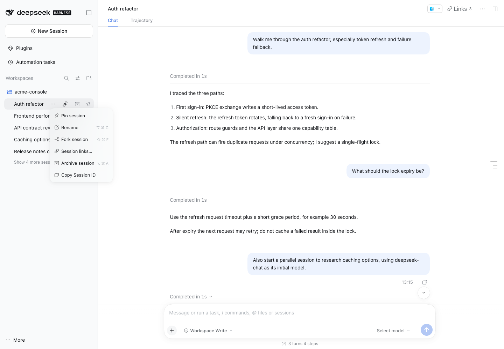
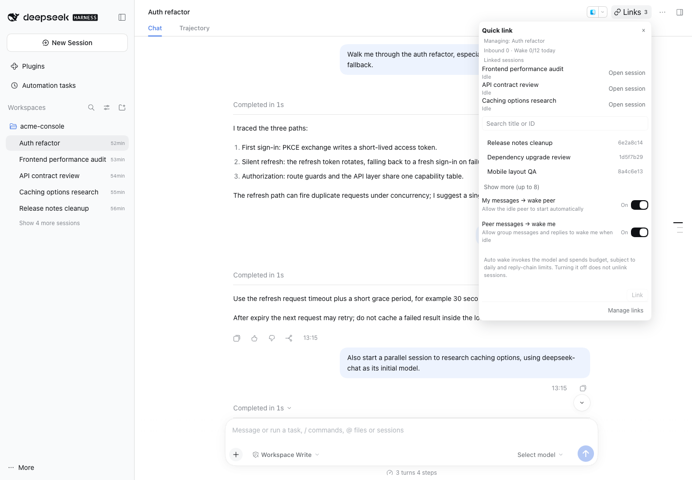
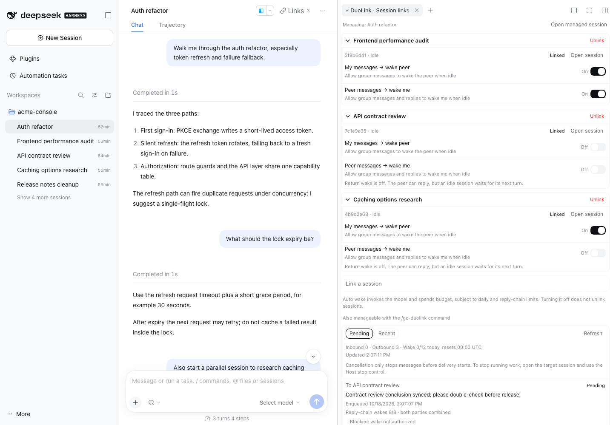
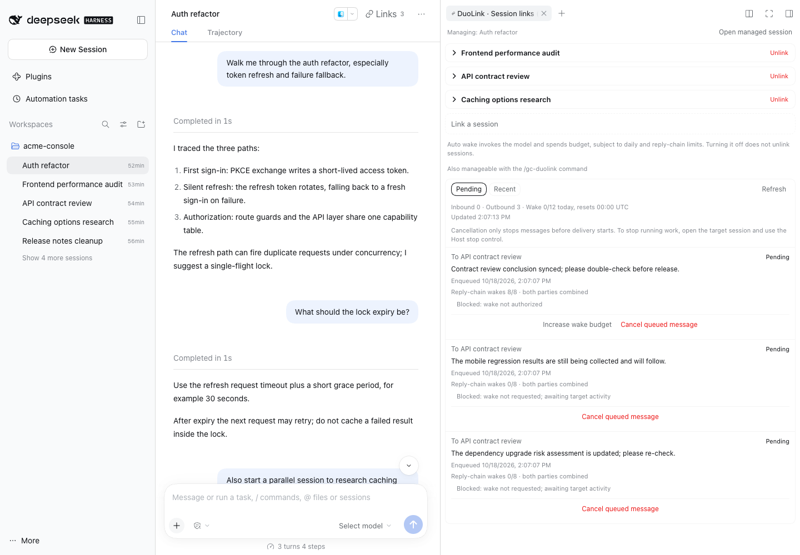
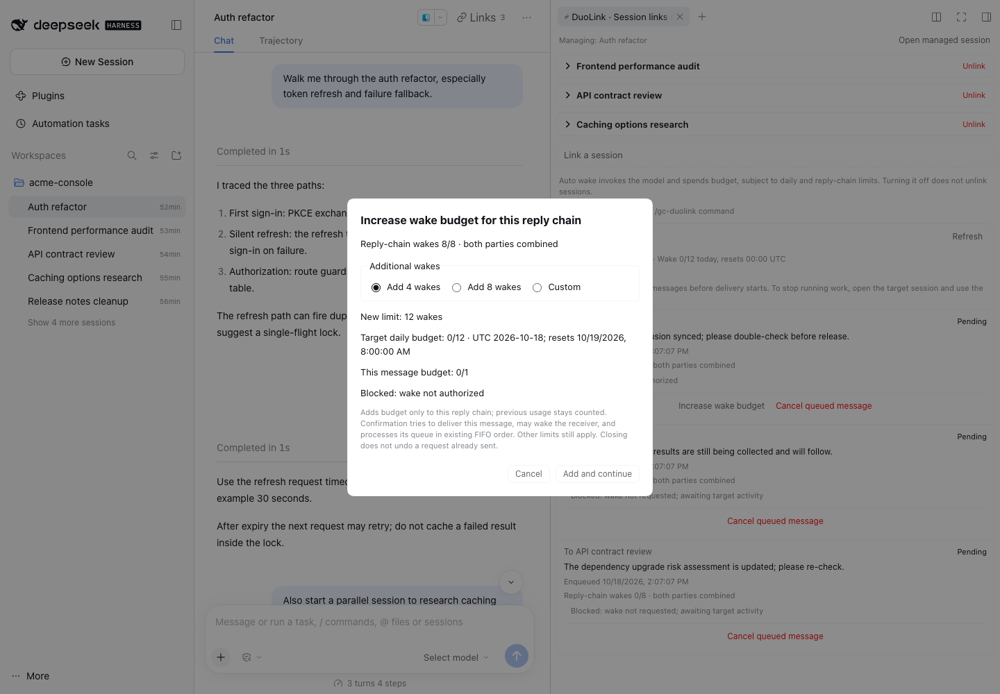
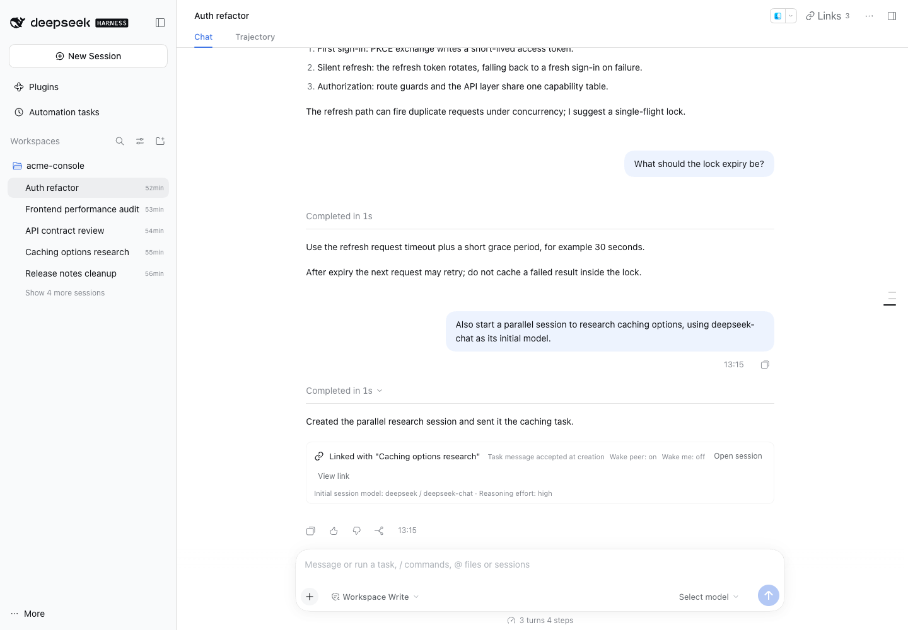

[中文](introduction.zh.md) | English

# DuoLink · Visual guide

`dsh-gc-duolink` (DuoLink) adds Session linking to DeepSeek Harness Desktop and Web: ordinary top-level Sessions exchange messages and wake a peer under explicit grants, while a right-side panel manages links, mail and wake budgets. It uses official DSH `0.2.0-rc.2` public APIs without changing the Host.

This guide describes preview version 0.6.1-beta; installation, configuration, verification scope and known limits are covered by the [README](../README.md).

## At a glance

- **Bidirectional links**: two ordinary top-level Sessions can message each other; they share message text, not model history or permissions. This guide uses the common two-Session case; a link group can hold up to 8 members.
- **Durable mail and wake grants**: messages are stored durably first. A running peer receives a follow-up; an idle peer is woken only when grants and budgets allow, otherwise it waits for its next turn.
- **Wake budgets**: automatic wakes are limited per Session per UTC day (12), per message (1) and per reply chain (8) by default; all three are configurable.
- **Right-panel management**: manage the clicked Session's links and wake switches and inspect its mail without switching the main conversation; **Open session** jumps to the peer Session.
- **Cancel and extend**: humans can cancel mail before delivery; when a reply chain is out of budget, they can add 4, 8 or a custom number of wakes to that chain only.
- **Spawn and supporting UI**: model tools create an ordinary top-level Session with Workspace placement, an optional initial model and an initial task; five `gc_duolink_*` tools and the `/gc-duolink` command cover day-to-day use, and the UI follows the Host language and theme.

## UI walkthrough

One common flow:

1. Open the quick linker from the Session header's **Links**, or open the management panel from the sidebar chain action / `… → Session links…`.
2. Pick an eligible ordinary top-level Session, confirm both wake directions and click **Link**.
3. In the right panel, open a peer, adjust wake switches or inspect the mailbox.
4. Cancel mail before delivery when needed; extend the reply chain when it is out of budget.
5. For parallel work, have the model call `gc_duolink_spawn_session` to create a linked Session with an initial model.

### Three entry points

*Figure 1 · Three entry points: the sidebar chain action, the "Session links…" entry in the native menu and the header "Links 3" button with its linked-Session count.*

The chain action on a Session row appears only when that Session has at least one link and disappears after the last one is removed, independently of execution and wake state. Both it and `… → Session links…` open the management panel for that Session without switching the main conversation. The Session header's **Links** button carries the linked-session count and opens **Quick link**. Copy Session ID still comes from the Host's built-in menu item; DuoLink adds no duplicate entry.

### Quick link

*Figure 2 · The "Quick link" dialog: managed Session summary, linked Sessions, search box, 3 recent candidates, two wake switches and the "Link" button.*

Pick an eligible ordinary top-level Session, confirm **My messages → wake peer** and **Peer messages → wake me**, then click **Link**. The picker initially lists the 3 most recently active candidates; **Show more (up to 8)** expands it to 8, and search matches all eligible Sessions before the display limit is applied. Both switches default to on and need confirmation; turning a switch off does not unlink the Sessions, it only disables automatic waking. The dialog's **Manage links** footer opens the right panel directly.

### Management panel

*Figure 3 · The right-side "DuoLink · Session links" panel: link cards, peer state, both wake directions and the add-link area.*

The **DuoLink · Session links** panel lists link cards for the managed Session. A pair card shows the peer title once in the card header, while the peer row below carries the ID, state, **Open session** and wake switches; a header **Unlink** asks for confirmation, and the title bar collapses the card. **Link a session** at the bottom opens the same picker. Labels follow the Host's shared language preference, and interface colors follow the Host theme variables.

### Mail and cancellation

*Figure 4 · The mailbox section at the bottom of the panel: "Pending" / "Recent" tabs, inbound/outbound and today's wake summary, enqueue times, blocking reasons and cancel buttons.*

**Pending** and **Recent** switch the mailbox views; the summary line shows inbound, outbound and today's wake usage. Pending rows show the enqueue time, known blocking reasons and reply-chain budget. Only ordinary mail that has not entered delivery enables **Cancel queued message**. **Refresh** re-reads the mailbox manually, and **Load more** appears while another page exists. The result is a snapshot: cancelled, already terminal, or too late; delivered content is never recalled. To stop running work, open the target Session and use the Host stop control.

### Increase wake budget

*Figure 5 · The "Increase wake budget for this reply chain" dialog: 4 / 8 / custom wakes, the new limit, the receiving Session's daily budget and remaining blockers.*

**Increase wake budget** appears next to a pending message only when its reply-chain budget is exhausted and the current snapshot allows an extension. The dialog never opens automatically: choose **Add 4 wakes**, **Add 8 wakes** or a custom 1–100, preview the new limit, and review the receiving Session's daily budget, this message's budget and any remaining blockers. **Add and continue** persists the extension and tries to deliver this message; Cancel writes nothing and wakes nobody. Extensions belong to the current reply chain and do not reset past usage.

### Spawned Session

*Figure 6 · After a spawn: the calling Session's turn-tail card shows the linked peer, delivery/wake states and the initial model, and the new Session also appears in the sidebar.*

Have the model call `gc_duolink_spawn_session` to create an ordinary top-level Session, link it and deliver its first task. Omitted `cwd` inherits the current directory and Workspace; an explicit **absolute** `cwd` creates or reuses that directory's Workspace. Query `gc_duolink_list_models` first when passing `initial_model`. The calling Session's turn-tail card (the card at the end of the spawn turn) names the new Session, shows **Initial session model: provider / model**, whether the task message was queued or accepted at creation, and both wake directions; **Open session** jumps to the new Session. The initial model configures that Session and does not prove execution success.

## Tools and commands

The model has five tools:

| Tool | Purpose |
|---|---|
| `gc_duolink_list_links` | List links and reachable Sessions. |
| `gc_duolink_send_message` | Send or reply; `wake: false` requests no idle wake; self-send and model selection are rejected. |
| `gc_duolink_cancel_message` | Cancel mail not yet inserted into the peer's Session. |
| `gc_duolink_spawn_session` | Create an ordinary Session, link it and deliver its initial task; optionally select its initial model. |
| `gc_duolink_list_models` | Query deployed provider / model / effort metadata, optionally filtered by `provider`. |

Humans can use `/gc-duolink` directly:

| Command | Purpose |
|---|---|
| `/gc-duolink list` | List this Session's links. |
| `/gc-duolink add <peer-session-id> [wake]` | Link with another Session; add `wake` to also wake the peer automatically. |
| `/gc-duolink wake <peer-session-id> on` or `off` | Toggle automatic wake for messages sent to that Session. |
| `/gc-duolink revoke <link-id>` | Remove the link. |

Tools and the command mount per preset on eligible top-level Agents; `minimal` and child Agents are excluded, and archived Sessions cannot invoke them.

## Boundaries

- Links share message text, not model history or permissions.
- `queued` / `accepted` are delivery states only; they never mean processed or completed, and delivery does not mean the model read it.
- Unlinking blocks undelivered mail but never stops a running Session or recalls delivered input.
- Mail and ledgers have no automatic cleanup; heavy long-running use needs attention to storage size.
- UI/command links carry human grants; spawn links carry Session grants, and replay preserves the original grants.

See the [README](../README.md) for installation and configuration, and [VERIFICATION.md](../VERIFICATION.md) for exact verification boundaries.
