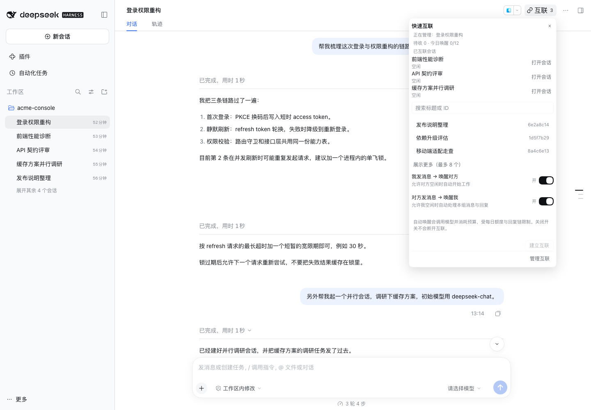
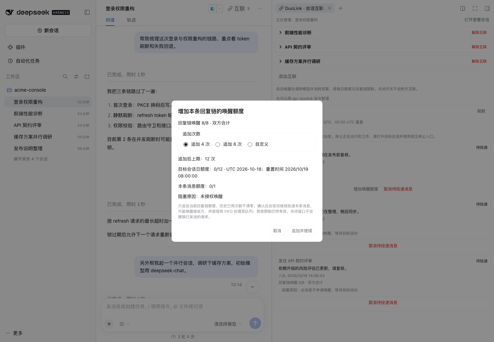

[English](introduction.md) | 简体中文

# DuoLink · 图文介绍

`dsh-gc-duolink`（DuoLink）是 DeepSeek Harness Desktop / Web 的会话互联插件：让两个普通顶层会话互发消息、按授权自动唤醒对方，并提供一个右侧面板来管理互联、邮箱与唤醒预算。插件只使用官方 DSH `0.2.0-rc.2` 公开接口，不修改宿主。

当前为预发布版本 0.6.1-beta；安装、配置、验证范围与已知限制见 [README](../README.zh.md)。

## 一眼看懂

- **双向互联**：两个普通顶层会话建立互联后可以互发消息；共享的是消息文本，不是模型历史或权限。本介绍以最常见的两两互联为例，一个互联组最多支持 8 个成员。
- **持久消息与唤醒授权**：消息先写入持久邮箱。目标正在运行时按 follow-up 接收；空闲时只有授权与预算允许才自动唤醒，否则等待下一轮工作。
- **唤醒预算**：自动唤醒受每日、单消息和回复链限制，默认每会话每 UTC 日 12 次、单消息 1 次、每条回复链 8 次，均可配置。
- **右侧面板管理**：管理被点击会话的互联、调整唤醒开关和查看邮箱都不必切换主对话；点「打开会话」会跳转到对端会话。
- **取消与追加额度**：人类可以在投递前取消待投递消息；回复链额度耗尽时可主动追加 4 次、8 次或自定义次数，只作用于该回复链。
- **新建会话与工具**：模型可新建普通顶层会话、指定其 Workspace、设置初始模型并投递首个任务；五个 `gc_duolink_*` 工具与 `/gc-duolink` 命令覆盖日常操作，界面跟随宿主语言和主题。

## 界面与交互

一次典型使用流程：

1. 从会话头栏「互联」打开快速互联，或从侧栏链条按钮 / `… → 会话互联…` 打开管理面板。
2. 选择一个可互联的普通顶层会话，确认两个方向的唤醒开关，点「建立互联」。
3. 在右侧面板里打开对端、调整唤醒开关，或查看邮箱。
4. 消息投递前可以取消；回复链额度耗尽时可以主动追加。
5. 需要并行工作时，让模型用 `gc_duolink_spawn_session` 新建带初始模型的会话。

### 三个入口

*图 1 · 三个入口：侧栏链条按钮、原生「…」菜单中的「会话互联…」，以及会话头栏带数量的「互联 3」按钮。*

会话列表右侧的链条按钮只在该会话已有至少一个互联时显示，解除最后一个互联后隐藏，与运行状态和唤醒开关无关；它和 `…` 菜单里的「会话互联…」都会打开该会话的管理面板，不切换主对话。会话头栏的「互联」按钮带数量角标，点击打开「快速互联」。复制会话 ID 仍使用 DSH 内置菜单项，DuoLink 不新增重复入口。

### 快速互联

*图 2 · 「快速互联」弹窗：当前受管会话摘要、已互联会话、搜索框、3 个最近候选、两个唤醒开关与「建立互联」。*

从当前会话选择一个可互联的普通顶层会话，确认「我发消息 → 唤醒对方」和「对方发消息 → 唤醒我」后点「建立互联」。候选默认显示最近活跃的 3 个，「展示更多（最多 8 个）」展开到 8 个；搜索会先匹配全部可互联会话，再应用显示数量限制。两个开关默认打开，需要确认；关闭开关不会断开互联，只取消自动唤醒。弹窗底部的「管理互联」会直接打开右侧面板。

### 右侧管理面板

*图 3 · 右侧「DuoLink · 会话互联」管理面板：互联卡片、对端状态、两个方向的唤醒开关与添加互联区域。*

右侧「DuoLink · 会话互联」面板按受管会话展示互联卡片。双人卡片只在标题显示一次对端会话名，卡片内是对端 ID、状态、打开会话和唤醒开关，标题栏右侧是带二次确认的「解除互联」；点击标题栏可折叠卡片。底部「添加互联」打开同一个选择器。面板文字跟随宿主语言偏好，界面配色跟随宿主主题变量。

### 消息与取消

*图 4 · 面板底部的消息区：「待处理 / 最近」标签、待收/待发与今日唤醒摘要、入队时间、阻塞原因和取消按钮。*

消息区用「待处理 / 最近」切换邮箱视图，摘要显示待收、待发与今日唤醒额度。待投递行会标出入队时间、当前阻塞原因和回复链预算；只有尚未进入投递的普通消息才会启用「取消待投递消息」。顶部「刷新」手动重新读取；分页未结束时底部会出现「加载更多」。取消结果是快照，可能返回已取消、已终结或已来不及；已交付内容不会撤回，要停止正在运行的工作请打开目标会话并使用宿主停止入口。

### 追加唤醒额度

*图 5 · 「增加本条回复链的唤醒额度」弹窗：追加 4 / 8 次或自定义，展示追加后上限、接收方日额度与剩余阻塞条件。*

只有回复链额度耗尽、且当前快照允许追加时，待投递消息旁才出现「增加唤醒额度」。窗口不会自动弹出：选择追加 4 次、8 次或自定义 1–100 次后会预览追加后上限，并列出接收会话的每日额度、本条消息额度以及仍存在的阻塞条件。点「追加并继续」才写入额度并尝试投递这条消息；取消不写入、不唤醒。追加只属于当前回复链，历史已用次数不清零。

### 新建会话

*图 6 · 新建会话完成后：调用方会话末尾的轨迹尾卡显示互联对象、投递状态、唤醒状态与「初始会话模型」，侧栏同时出现新的顶层会话。*

让模型调用 `gc_duolink_spawn_session`，即可新建一个普通顶层会话、建立互联并投递首个任务。省略 `cwd` 时沿用当前目录和 Workspace；显式传入绝对 `cwd` 时会创建或复用该目录的 Workspace。需要初始模型时先查 `gc_duolink_list_models`，再传 `initial_model`。调用方会话末尾的轨迹尾卡（即本轮对话结束处的卡片）会显示新会话名称、「初始会话模型: provider / model」、任务消息是「已入队」还是「已受理」，以及两个方向的唤醒状态；「打开会话」可直接进入新会话。初始模型只是新会话的配置，不表示任务执行成功。

## 工具与命令

模型可以使用五个工具：

| 工具 | 用途 |
|---|---|
| `gc_duolink_list_links` | 查询互联组与可达会话。 |
| `gc_duolink_send_message` | 发送或回复消息；`wake: false` 表示不申请空闲唤醒；不能发给自己，也不支持选模。 |
| `gc_duolink_cancel_message` | 取消尚未插入对方会话的消息。 |
| `gc_duolink_spawn_session` | 新建普通会话、建立互联并投递初始任务，可选初始模型。 |
| `gc_duolink_list_models` | 查询已部署的 provider / model / effort 元数据，可按 `provider` 过滤。 |

人类可以直接使用 `/gc-duolink`：

| 命令 | 用途 |
|---|---|
| `/gc-duolink list` | 查看本会话的互联组。 |
| `/gc-duolink add <peer-session-id> [wake]` | 与指定会话建立互联；加 `wake` 时同时开启对端自动唤醒。 |
| `/gc-duolink wake <peer-session-id> on` 或 `off` | 开启或关闭发往该会话的自动唤醒。 |
| `/gc-duolink revoke <link-id>` | 解除指定互联组。 |

工具与命令按 preset 挂载在符合条件的顶层 Agent 上，`minimal` 与子代理不挂载；归档会话不能调用这些工具与命令。

## 边界

- 互联共享的是消息文本，不是模型历史或权限。
- `queued` / `accepted` 只是投递状态，不表示对方已处理或完成任务；送达也不等于模型已读。
- 解除互联只阻止尚未投递的消息，不会停止正在运行的会话，也不会撤回已交付内容。
- 邮箱和台账不会自动清理，长期大量使用需要关注规模。
- UI / 命令建立的互联携带人类授权，spawn 建立的互联携带会话授权；重放沿用首次固化的授权。

安装与配置见 [README](../README.zh.md)，验证范围与准确边界见 [VERIFICATION.md](../VERIFICATION.md)。
